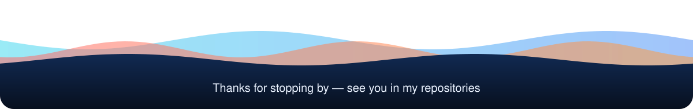

<!--
  Maintenance notes
  • Animated visuals: /assets (original SVGs stored in this repository)
  • Stats + snake: /profile, regenerated daily by .github/workflows/profile-cards.yml
  • When a project repository is published, add its link in section 03
-->

<picture>
  <source media="(prefers-color-scheme: dark)" srcset="./assets/banner-dark.svg">
  <source media="(prefers-color-scheme: light)" srcset="./assets/banner-light.svg">
  
</picture>

<p align="center">
  <picture>
    <source media="(prefers-color-scheme: dark)" srcset="https://readme-typing-svg.demolab.com?font=JetBrains+Mono&weight=600&size=20&duration=2800&pause=1400&color=22D3EE&center=true&vCenter=true&width=640&height=44&lines=Hi,+I%27m+Douae+Amrani;Application+Development+%E2%80%94+BTS+DAI;Turning+everyday+workflows+into+software;Web+%C2%B7+Desktop+%C2%B7+Mobile">
    
  </picture>
</p>


## 01 · About me

I'm **Douae**, a **BTS graduate in Application Development** *(Développement des Applications Informatiques – DAI)*.
Through academic projects and two internships, I've built **web, desktop and mobile** applications — mostly management systems that turn everyday workflows into structured software.

My direction is **Software Development**, and every project is a chance to learn something new.


## 02 · Tech I've worked with

<p align="center">
  <picture>
    <source media="(prefers-color-scheme: dark)" srcset="https://skillicons.dev/icons?i=java,cs,js,php,py,c,html,css,laravel,bootstrap,postgres,mysql,sqlite,git,github,vscode,visualstudio,androidstudio&perline=9&theme=dark">
    
  </picture>
</p>

| Area | Technologies |
|:--|:--|
| 🔷 **Languages** | Java · C# · JavaScript 🔄 · PHP 🔄 · Python · C |
| 🌐 **Web** | HTML5 · CSS3 · Java EE *(Servlets, JSP)* · Laravel 🔄 · Bootstrap 5 |
| 🗄️ **Databases** | PostgreSQL · MySQL · SQLite |
| 🧰 **Tools** | Git & GitHub · Apache Tomcat · NetBeans · Visual Studio · VS Code · Android Studio |
| 🧩 **Concepts** | MVC · CRUD · UML · Merise · Responsive design |

<sub>Studied and used in academic projects and internships · 🔄 currently revisiting</sub>


## 03 · Projects &nbsp;



**🩻 RadioVision** · *main academic project* — a Java EE web application that manages a radiology center, from online booking to published medical reports.

<details>
<summary><b>Main features</b></summary>
<br>

- Five roles: Patient, Secretary, Radiologist, Technician, Administrator
- Online booking with real-time slot availability
- Advance payment *(simulated)* with automatic expiration after 3 hours
- Arrival check-in, final payment and PDF invoices
- Medical reports written, validated and published online
- Equipment monitoring and an admin dashboard with statistics
- Role-based access control and hashed passwords

<sub>Java EE · Servlets · JSP · Java Beans · JDBC · MVC · PostgreSQL · Bootstrap 5 · AJAX · Chart.js · Apache Tomcat</sub>

</details>

<!-- When published: [View repository →](https://github.com/douaeamr20/REPOSITORY_NAME) -->

<table>
  <tr>
    <td width="50%" valign="top">

**🎓 Doctoral Defense Management System**

Internship project at the **Centre des Études Doctorales**, Université Ibn Tofail, Kénitra — a web application to facilitate doctoral defense procedures.

`Laravel`

</td>
    <td width="50%" valign="top">

**📱 Responsive Website**

Internship project at **XCO Agency** — a website that adapts to desktop, tablet and mobile screens.

`HTML5` `CSS3`

</td>
  </tr>
</table>

<sub>Repositories are being prepared — links will appear here once published.</sub>


## 04 · GitHub activity

<p align="center">
  
  <!-- After publishing 2–3 repositories, remove the comment markers to show top languages:
  
  -->
</p>

<picture>
  <source media="(prefers-color-scheme: dark)" srcset="./profile/snake-dark.svg">
  <source media="(prefers-color-scheme: light)" srcset="./profile/snake-light.svg">
  
</picture>


## 05 · Currently learning

```java
while (learning) {
    revisit("JavaScript", "PHP", "Laravel");
    build();   // and publish my projects here, one clean repository at a time
}
```


## 06 · Contact

<p align="center">
  <a href="mailto:ouchrifdouae@gmail.com"></a>
  <br>
  <a href="mailto:ouchrifdouae@gmail.com"><b>amranidouae116@gmail.com</b></a>
</p>


